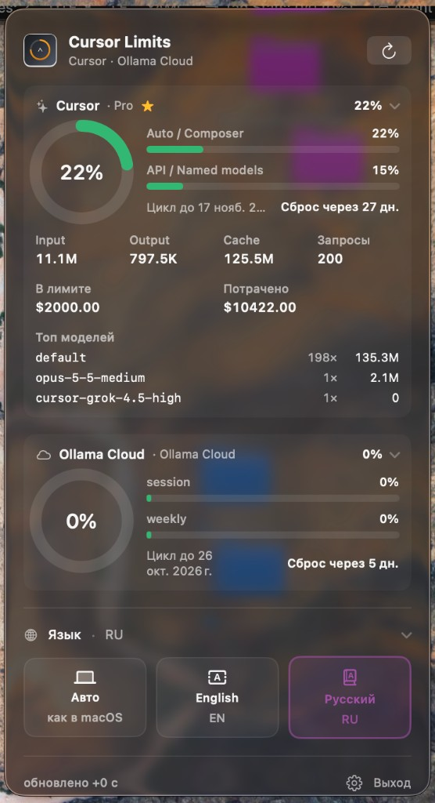
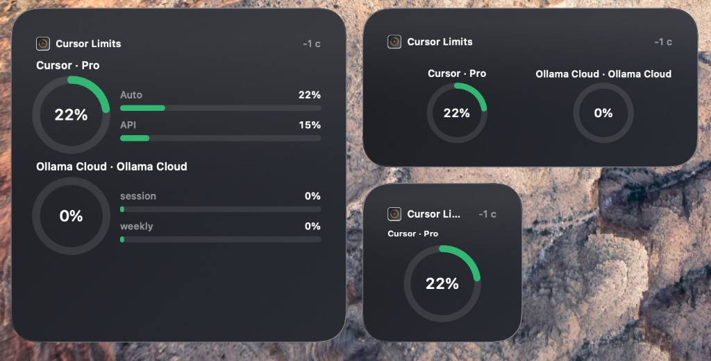

# Cursor Limits

*[English](README.md) · Русский*

Меню-бар и виджеты macOS с **лимитами AI-подписок**: Cursor, Claude Code, Codex,
Ollama Cloud, OpenCode Go и GitHub Copilot.

Токены вставлять не нужно: приложение читает локальные сессии и ходит только на
официальные API провайдеров. Данные usage остаются на этом Mac.

[](https://github.com/5tepan/cursor-limits-widget/releases/latest)
[](LICENSE)

**[Скачать последний релиз](https://github.com/5tepan/cursor-limits-widget/releases/latest)** —
`CursorLimits-*-macos.zip` → **Install.command**.

## Скриншоты

<p align="center">
  
</p>

<p align="center"><em>Меню-бар — живой usage по каждому подключённому провайдеру</em></p>

<p align="center">
  
</p>

<p align="center"><em>Виджеты на рабочем столе (small / medium / large). <strong>Важно:</strong> WidgetKit пока нестабилен на многих установках — особенно ad-hoc / CI-сборки без подписи Apple Development или нотаризованного Developer ID. Сейчас надёжная поверхность — меню-бар; виджеты могут не появляться или не обновляться.</em></p>

## Что умеет

| Поверхность | Поведение |
|---|---|
| **Меню-бар** | % основного провайдера; раскрываемые карточки по каждому источнику |
| **Настройки** | Включение провайдеров, primary (или авто по максимальному usage), язык, Copilot device flow |
| **Виджеты** | Small / medium / large (сначала primary; остальное — в меню-баре) |
| **При запуске** | Пробует все провайдеры, без локальной сессии — выключает |

## Требования

- macOS 14+
- Для сборки из исходников: Xcode / CLT и [xcodegen](https://github.com/yonaskolb/XcodeGen)
- Вход в нужные инструменты на этом Mac

## Установка

1. Скачайте zip из [Releases](https://github.com/5tepan/cursor-limits-widget/releases/latest).
2. Распакуйте → дважды нажмите **Install.command** (ставит в `/Программы`).
3. Если macOS блокирует: ПКМ → **Открыть** → **Открыть** (сборки с CI часто без нотаризации).
4. Войдите в инструменты → иконка в меню-баре → обновить. Провайдеры — в **Настройках**.
5. Рабочий стол → **Редактировать виджеты** → **Cursor Limits**.

Из исходников:

```bash
brew install xcodegen
./scripts/install-local.sh
./scripts/package.sh
```

## Приватность

Токены никуда не «загружаются» на бэкенд Cursor Limits. Подробности —
[SECURITY.md](SECURITY.md).

## Документация

- [Архитектура](docs/architecture.md)
- [Контракт snapshot](docs/snapshot-contract.md) — файловый мост для внешних UI (Cyclop и др.)
- [Провайдеры](docs/providers.md)
- [Changelog](CHANGELOG.md) — что нового по версиям
- [Contributing](CONTRIBUTING.md)

## Ограничения

- **Виджеты на рабочем столе пока могут не работать** (нет в галерее, устаревшие данные). Надёжнее локальная сборка с **Apple Development** через `./scripts/install-local.sh`; ad-hoc zip из релиза часто даёт только рабочий меню-бар.
- API провайдеров меняются; ошибка refresh пишется в локальный журнал с редакцией секретов.
- OpenCode Go принимает только явно именованные Go-ключи.

## Лицензия

[MIT](LICENSE)
